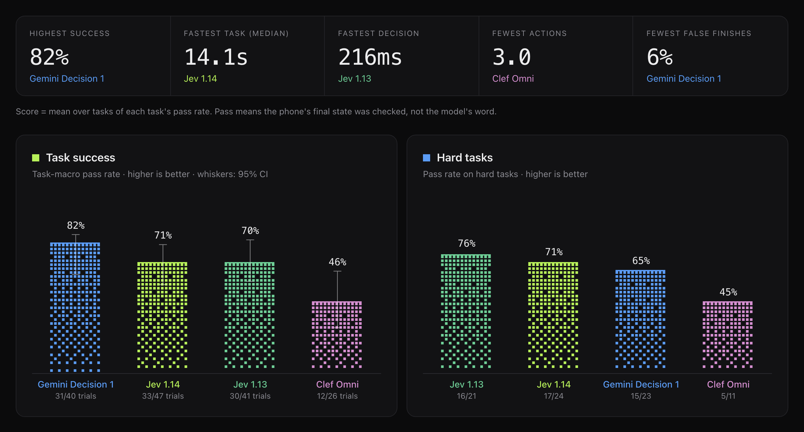

# PhoneBench


**Can a decision model drive a real iPhone?**

PhoneBench gives a model a goal, like *"find a MrBeast video and start watching it"* or *"which of my classes has
the lowest grade?"*, and lets it operate a physical iPhone one action at a time through the accessibility tree and a
screenshot. A programmatic check of the phone's final state decides whether it succeeded. The model's word is never
trusted.

Decision models (TypeSafe **Jev**, Google **Gemini Decision**, Cloudflare **Clef**, open-weights **Strands Decider**)
don't write text. They answer typed questions (pick one option, give a probability) in a few hundred milliseconds.
PhoneBench asks whether that is enough to *use a phone*: navigate real apps, get past pop-ups, know when the job is
done, and know when a job is impossible.



## Results

> **v0.7 (preview)** · 154 graded trials on a physical iPhone 17 (iOS 27) · 31 tasks · 4 models.
> Repeats are still running, so the intervals are wide. Clef Flash, Clef and Strands Decider are not on the phone yet.
> Every trial, the grader audit and the full tables: [`results/v0.7`](results/v0.7/RESULTS.md).

| # | Model | Score | Pass / trials | 95% CI | Median time to pass | Decision p50 | False finishes |
|---|---|---|---|---|---|---|---|
| 1 | Gemini Decision 1 | **82%** | 31 / 40 | 62–88% | 18.5 s | 880 ms | 6% |
| 2 | Jev 1.14 | **71%** | 33 / 47 | 56–81% | 14.1 s | 222 ms | 18% |
| 3 | Jev 1.13 | **70%** | 30 / 41 | 58–84% | 15.0 s | 216 ms | 16% |
| 4 | Clef Omni | **46%** | 12 / 26 | 29–65% | 17.5 s | 471 ms | 17% |

*Score is the mean over tasks of each task's pass rate, so a task with more repeats doesn't count more.
False finishes: the share of feasible trials where the model said FINISH and the goal wasn't met.*

### What the trials show

- **Gemini is the most careful; Jev is the fastest.** Jev decides in about 220 ms against Gemini's 880 ms and
  finishes passing tasks about 3 s sooner. Jev declares success too early far more often (14–18% vs 6%).
- **The model is rarely the bottleneck.** Only 7–9% of Jev's task time is spent in the model. The rest is the
  phone: launching apps, waiting for animations, capturing the screen.
- **Look-alike apps trip up Jev.** Asked to use *Gmail*, it opened Apple Mail. Asked for *Google Maps*, it
  opened Apple Maps. Both times it reported success.
- **Gemini sometimes gives up too early.** It opened the Finance folder, didn't see Stocks there, and declared
  the task impossible, even though "open the Stocks app" was one of its options.
- **Clef Omni gets stuck.** Most of its failures are loops: tapping the same control, or swiping back over and over.
  When it does finish a task, it takes the fewest actions of any model (median 3).
- **Nobody solves the reasoning tasks yet** (0 of 4 trials), and four tasks have never been passed by any model:
  an X profile, an Amazon product page (a Prime upsell blocks the way), the App Store developer lookup and Gmail.


### Judged track

Open-ended goals: the best-rated coffee shop nearby, a Reddit post with genuinely useful battery advice, a tire-change
tutorial under 10 minutes, a vegetarian dinner to order. Claude Opus 5.5 grades each trajectory against the task's
written rubric, and every verdict comes with a reason in [`judgments.json`](results/v0.7/judgments.json). So far:
Clef Omni 2 / 5. Other models are queued.

### Simulator track

The same harness on the iOS Simulator, for the tasks that run there (built-in apps and Safari). It is cheaper and
fully reproducible, so it's the place to try local models. It is reported separately and never pooled with the phone.

| Model | Pass / trials | 95% CI | Median time to pass | Decision p50 |
|---|---|---|---|---|
| Jev 1.14 | 27 / 27 | 88–100% | 13.2 s | 209 ms |
| Jev 1.13 | 23 / 27 | 68–94% | 11.5 s | 185 ms |
| Strands Decider 2B (local, RTX 3060) | 4 / 18 | 9–45% | 5.2 s | 696 ms |

**Strands Decider 2B** is a 2-billion-parameter open-weights decision model running on a 6 GB laptop GPU. It
navigates surprisingly well, but in half its failures it reached the right screen (the answer on the page, the
right contact open) and then kept tapping the answer instead of choosing FINISH. Knowing when you're done is the
skill a small model lacks.

### Does the screenshot matter?

Same model, same simulator tasks, with and without the screenshot:

| Model | Accessibility tree + screenshot | Accessibility tree only |
|---|---|---|
| Jev 1.14 | 27 / 27 (100%) | 15 / 18 (83%) |
| Strands Decider 2B | 4 / 18 (22%) | 5 / 18 (28%) |

Jev uses the picture. The small local model gains nothing from it.

## How it works

```
reset the task's apps to a verified root view → Home screen → start the clock
loop:  observe (accessibility tree + screenshot) → ask the model for ONE action → execute it
until: FINISH · INFEASIBLE · 240 s · same action on an unchanged screen 6×
grade: programmatic check of the phone's final state (+ trajectory for multi-app tasks)
```

- **One generic action space for every task.** The model can tap any visible element, type a task string, press
  Return, scroll, go back, go Home, open any of 20+ apps (look-alikes included), wait, FINISH or INFEASIBLE. There
  are no per-task hints.
- **No step budget.** A step cap measures the cap, not the model. Every stop reason is reported.
- **Infeasible tasks** (as in OSWorld). The right answer is to say the task can't be done. Saying INFEASIBLE on a
  feasible task is a failure.
- **Graded on state, then audited by Claude Opus 5.5.** Checks are pure functions of saved snapshots, so a fixed
  check re-scores every past trial (`phonebench.regrade`). Every release also ships a review by Claude Opus 5.5 of
  every failure and at least a quarter of the passes. The reviewer reads the saved screens and action log, gives its own
  verdict and writes a one-line reason. v0.7: 93 trials reviewed. The review found three grader bugs (two wrong
  failures, one check that could have passed a trial that did nothing). After those fixes the grader agrees with the
  reviewer on every reviewed trial.
- **Harness problems are never model failures.** A failed reset, a dropped USB connection or a rate limit excludes
  the trial and lists it.
- **Open-ended tasks are judged by Claude Opus 5.5.** For goals like *"find a good vegetarian dinner nearby"*, it grades the
  trajectory against a rubric. These are scored on their own track.
- **Safe by construction.** Send, buy, install, follow, like, post, delete, trial, sign-up, confirm and start-navigation
  controls are never offered, and no switch is ever tappable. The driver independently blocks taps that spend money. Mail and
  Messages are sent to the model as text only, never as screenshots.

The full protocol, metrics and failure taxonomy are in [`docs/METHOD.md`](docs/METHOD.md).

## Tasks

41 tasks across 20 apps: YouTube, X, Reddit, Weather, Apple Maps, Google Maps, Stocks, Calculator, Notes,
Settings, Safari, Amazon, App Store, Gmail, Contacts, Reminders, Calendar, Uber Eats, DoorDash and a school portal.

| Kind | What it asks |
|---|---|
| navigate | reach a specific screen (a channel's Videos tab, walking directions, a sorted feed) |
| info | find a fact and answer a multiple-choice question about it |
| reasoning | compare things on screen and act on the result (open the class with the lowest grade) |
| multi-app | carry something from one app to another |
| compute / write | use Calculator, create a note or a reminder |
| infeasible | ask for an app or feature the phone doesn't have |
| judged | open-ended goals graded against a rubric |

21 tasks are hard. Five use personal data (a school portal) and run only when you supply your own values in
`config/private.json`; their answers are never published. Every task is listed in [`docs/TASKS.md`](docs/TASKS.md).

## Reproduce

Three levels, from checking our numbers without a device to running it on your own phone. They are all in
[`docs/REPRODUCE.md`](docs/REPRODUCE.md). CI re-derives every published summary from its trials on each push.

You need a Mac with Xcode, Python 3.10+ (standard library only) and [phonedriver](https://www.npmjs.com/package/phonedriver).
For the phone track, add an iPhone in Developer Mode connected over USB. The simulator track needs no phone.

```sh
npx -y phonedriver doctor                      # checks Xcode, the runner and any connected devices
cp config/private.example.json config/private.json   # optional: your own values for the personal-data tasks

# API keys go in .env or ~/.config/phonebench/env (never committed):
#   TYPESAFE_API_KEY  GEMINI_API_KEY  CLOUDFLARE_API_TOKEN  CLOUDFLARE_ACCOUNT_ID

# phone track
python3 -m phonebench.runner --providers jev-1.14 gemini-decision-1 --repeats 3

# simulator track: boot one first with `npx phonedriver boot "iPhone 17 Pro"`
PHONEBENCH_DEVICE=sim:<udid> python3 -m phonebench.runner --device-kind sim --out runs-sim --providers jev-1.14

# a local open-weights model: serve it, then point the runner at it
pip install "strands-decider[vision]"
strands-decider serve StrandsAgents/strands-decider-2B-qwen3.5-v1-2610 --vision --port 8765
STRANDS_URL=http://127.0.0.1:8765 python3 -m phonebench.runner --providers strands-2b

# grade, report, render, audit
python3 -m phonebench.regrade runs runs-sim --carry results/archive/v6-graded.jsonl --release results/vX
python3 -m phonebench.report results/vX
python3 scripts/build_site.py results/vX       # site/ + the README images (needs Playwright)
python3 scripts/audit.py                        # benchmark-quality audit
```

Raw runs (screenshots and screen text) stay in `runs/`, which is git-ignored. Only ids, outcomes, counts and
timings are published.

## Limitations

- **One phone, one account, one network.** Absolute times are specific to this setup. The comparisons between
  models are what transfer.
- **Live apps change.** Feeds, ads and store sheets differ from run to run. That's realistic, and it's why each
  cell is repeated and reported with an interval.
- **Preview sample sizes.** Most model × task cells have 1–2 trials so far, and the goal is 3 or more.
- **Free tiers shape coverage.** Gemini is rate-limited (waits are excluded from its timings), and Cloudflare's
  daily free allocation caps Clef trials per day.
- **One safety gap was found and closed.** A model tapped an Apple Maps suggestion row that starts turn-by-turn
  navigation in one tap, which the filter didn't yet block. Navigation starts (Go, Start, Resume, "From My Location"
  rows) are now never offered, the Maps reset ends any active route, and later trials that opened into the leftover
  navigation are excluded.
- **TikTok is excluded.** Its accessibility tree hangs the XCUITest runner.
- **The reviewer is an AI.** Grading is programmatic; the audit of the grader and the open-ended tasks are judged by
  Claude Opus 5.5, not a human. Its verdicts and reasons are published so anyone can check them.
- **Decision models can't invent text.** Strings a task needs are offered as options, so PhoneBench measures
  operating the phone, not composing messages.
- **58 early trials are archived.** Their raw snapshots no longer exist, so they keep their original grades
  (`results/archive/`) and can't be re-graded.

## Layout

```
phonebench/   runner, environment (resets + action space), tasks, providers, safety, regrade, report, version stamps
docs/         METHOD.md, TASKS.md, REPRODUCE.md
results/vX/   trials.jsonl, summary.json, RESULTS.md, grader_audit.json
site/         index.html (dithered charts), assets/*.png
scripts/      audit.py, build_site.py, gen_docs.py, phone_queue.sh
tests/        unit tests (safety filter, action space, grading, wire formats, stats)
```

## License

MIT
