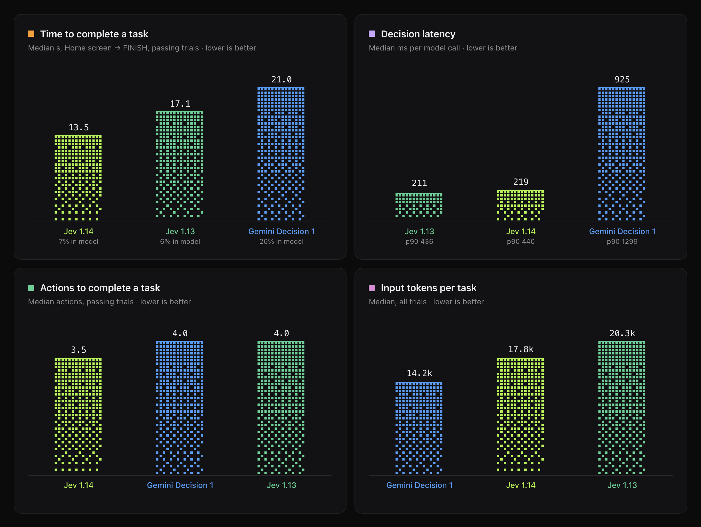
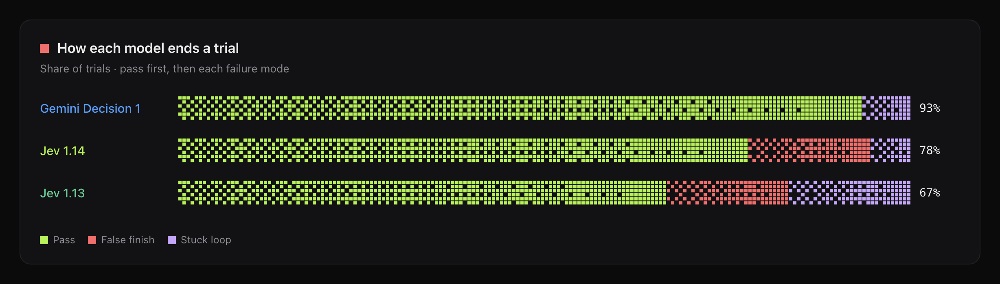
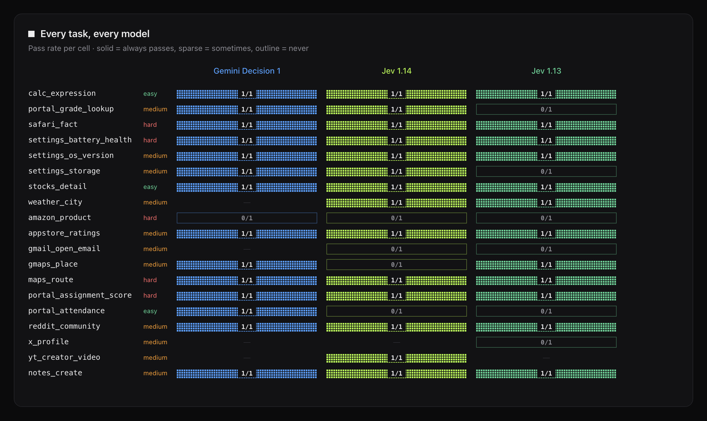

# PhoneBench

**Can a decision model drive a real iPhone?** PhoneBench gives a model a goal ("find a MrBeast video and
start watching it", "which of my classes has the lowest grade?") and lets it operate a physical iPhone,
one action at a time, through the accessibility tree and a screenshot. A programmatic check of the phone's
final state decides whether it succeeded. The model's word is never trusted.

Decision models (TypeSafe **Jev**, Google **Gemini Decision**, Cloudflare **Clef**) don't write text. They
answer typed questions (pick one option, give a probability) in a few hundred milliseconds. PhoneBench asks
whether that's enough to *use a phone*: navigate real apps, recover from pop-ups, know when it's done, and
know when a task is impossible.


## Results

> Release **v0.6**: 51 graded trials, 19 real-app tasks, 3 models, one physical iPhone (iOS 27).
> The full table, every trial and the hand audit of the grader are in [`results/v0.6`](results/v0.6/RESULTS.md).
> Runs continue toward ≥3 repeats per model × task on the full 30-task suite.

| Model | Score | Pass / trials | 95% CI | Median time to pass | Decision p50 | False finishes |
|---|---|---|---|---|---|---|
| Gemini Decision 1 | **93%** | 14/15 | 70–99% | 21.0 s | 925 ms | 0% |
| Jev 1.14 | **78%** | 14/18 | 55–91% | 13.5 s | 219 ms | 17% |
| Jev 1.13 | **67%** | 12/18 | 44–84% | 17.1 s | 211 ms | 17% |

What the trials show:

- **Gemini Decision is the most careful; Jev is the fastest.** Jev's decisions take a quarter of the time
  (≈220 ms vs ≈925 ms), so Jev finishes a task 35% sooner when it does finish. Gemini never declared
  success early. Both Jevs did, in 17% of feasible trials.
- **The model is not the bottleneck.** On Jev, only 6–7% of task time is spent in the model; the rest is the
  phone (launching apps, settling animations, capturing the screen). Faster models would barely change
  end-to-end time. Faster devices and fewer observations would.
- **Wrong-app confusion is the commonest Jev failure.** Asked to use *Gmail*, both Jevs opened Apple Mail. Asked
  for *Google Maps*, Jev 1.14 opened Apple Maps. Each then reported success.
- **Nobody gets past an upsell.** Amazon opens on a Prime "$0 trial" sheet whose decline link sits below the
  fold. All three models swiped *back* over and over instead of scrolling: 0/3.
- Gemini's free tier rate-limits at 50k input tokens/min. Waits are excluded from its timings, but four of
  its trials were lost to the limit in this release (listed as excluded, never as failures).







## How it works

```
reset the task's apps to a verified root view → Home screen → start the clock
loop:  observe (accessibility tree + screenshot) → ask the model for ONE action → execute it
until: FINISH · INFEASIBLE · 240 s · same action on an unchanged screen 6×
grade: programmatic check on the phone's final state (+ trajectory for multi-app tasks)
```

- **One generic action space for every task**: tap any visible element, type a task string, Return, scroll,
  back, Home, open any of 26 apps (look-alikes included), wait, FINISH, INFEASIBLE. No per-task hints.
- **No step budget.** A cap measures the cap, not the model. Every stop reason is reported.
- **Infeasible tasks** (as in OSWorld): the right answer is to say it can't be done. Saying INFEASIBLE on a
  feasible task is a failure.
- **Graded on state, audited by hand.** Checks are pure functions of saved snapshots, so a fixed check can
  re-score every past trial (`phonebench.regrade`). Each release ships a human review of every failure and a
  quarter of passes. v0.6: 25/25 agreement.
- **Safe by construction.** Send, buy, install, follow, like, post, delete, trial, sign-up and confirm controls
  are never offered, and no switch is ever tappable. phonedriver independently blocks money-spending taps.

Full protocol, metrics and failure taxonomy: [`docs/METHOD.md`](docs/METHOD.md).

## Tasks

30 tasks across 15+ apps: YouTube, X, Reddit, Weather, Apple Maps, Google Maps, Stocks, Calculator, Notes,
Settings, Safari, Amazon, App Store, Gmail and a school portal. They come in seven kinds: navigate, info
lookup (with a multiple-choice answer), reasoning, multi-app, compute, write and infeasible. 12 are hard.
Every task is listed in [`docs/TASKS.md`](docs/TASKS.md).

## Reproduce

Needs macOS with Xcode, an iPhone in Developer Mode connected over USB, and
[phonedriver](https://www.npmjs.com/package/phonedriver) (`npx -y phonedriver doctor`). Python 3.10+, no
dependencies (Playwright only to render charts).

```sh
# keys: TYPESAFE_API_KEY, GEMINI_API_KEY, CLOUDFLARE_API_TOKEN, CLOUDFLARE_ACCOUNT_ID
cp config/private.example.json config/private.json    # optional: personal-data tasks
python3 -m phonebench.runner --providers jev-1.14 gemini-decision-1 --repeats 3
python3 -m phonebench.regrade runs --release results/vX
python3 -m phonebench.report results/vX
python3 scripts/build_site.py results/vX               # site/ + README images
python3 scripts/audit.py                                # benchmark-quality audit, must print failing=0
```

Raw runs (screenshots, screen text) stay in `runs/`, which is git-ignored. Only ids, outcomes, counts and
timings are published.

## Limitations

- **One phone, one account, one network.** Absolute times are specific to this setup; the comparisons between
  models are what transfers.
- **Live apps change.** Feeds, ads and store sheets differ between runs. That's realistic, and it's why each cell
  is repeated and reported with an interval.
- **Small samples so far.** v0.6 has one trial per model × task; intervals are wide. Read the ranking as
  provisional until the ≥3-repeat release.
- **Free tiers shape coverage.** Gemini is rate-limited; Cloudflare's daily free allocation caps Clef trials per day.
- **TikTok is excluded**: its accessibility tree hangs the XCUITest runner.
- **Decision models can't invent text.** Strings a task needs are offered as options, so this measures operating
  the phone, not composing messages.

## Layout

```
phonebench/   runner, environment (resets + action space), tasks, providers, safety, regrade, report
docs/         METHOD.md, TASKS.md
results/vX/   trials.jsonl, summary.json, RESULTS.md, grader_audit.json
site/         index.html (dithered charts), assets/*.png
scripts/      audit.py, build_site.py, gen_docs.py
tests/        unit tests (safety filter, action space, grading, wire formats, stats)
```
